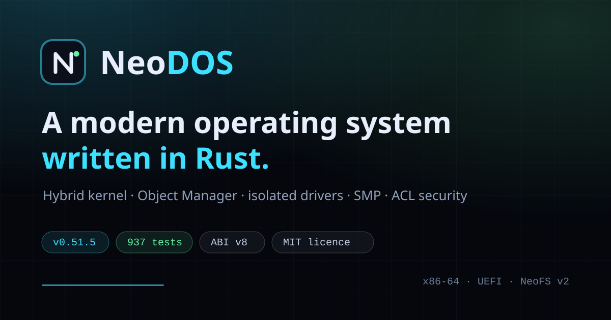

<p align="center">
  
</p>

<h1 align="center">NeoDOS</h1>

<p align="center">
  A modern 64-bit operating system written in Rust for x86-64.<br>
  Hybrid kernel · Object Manager · isolated drivers · SMP · ACL security
</p>

<p align="center">
  <a href="https://neodos-project.github.io/neodos-web/"><strong>Website</strong></a> ·
  <a href="https://github.com/NeoDOS-Project/NeoDOS">Main repository</a> ·
  <a href="https://github.com/NeoDOS-Project/NeoDOS/blob/develop/ROADMAP.md">Roadmap</a> ·
  <a href="https://github.com/NeoDOS-Project/NeoDOS/blob/develop/docs/README.md">Documentation</a>
</p>

## Repositories

| Repository | Description |
|------------|-------------|
| [NeoDOS](https://github.com/NeoDOS-Project/NeoDOS) | Kernel, bootloader, drivers, userland, tools and documentation |
| [NeoDev](https://github.com/NeoDOS-Project/NeoDev) | Build, image, run and test toolchain |
| [NeoTools](https://github.com/NeoDOS-Project/NeoTools) | Host utilities for NeoDOS binaries: `nxeinfo`, `nxpkg`, `nxdump` |
| [neodos-dev-server](https://github.com/NeoDOS-Project/neodos-dev-server) | LSP server + MCP server + shared toolkit |
| [.github](https://github.com/NeoDOS-Project/.github) | Community health files, issue and PR templates |

## Quick start

```bash
cargo install --git https://github.com/NeoDOS-Project/NeoDev.git
gh repo clone NeoDOS-Project/NeoDOS
cd NeoDOS
neodev build --image
neodev run
```

---

<p align="center">
  MIT licensed · experimental software, use at your own risk
</p>